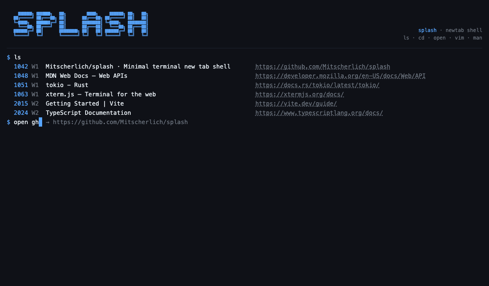
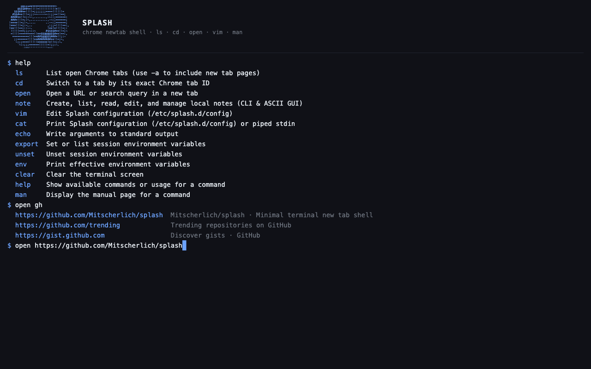
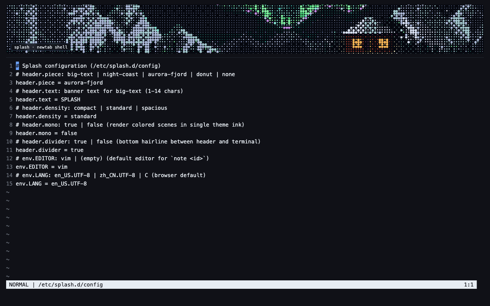
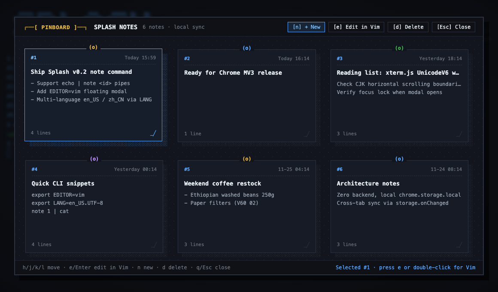
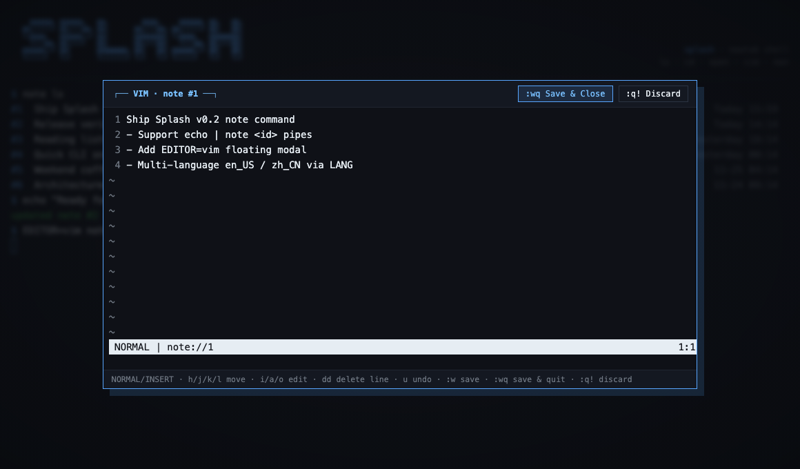

# Splash

A minimal terminal new tab shell for Chrome, built with [`@xterm/xterm`](https://xtermjs.org/), TypeScript, Vite, and [`ascii.rest`](https://ascii.rest/docs/) animated ASCII headers.



## Features

- **Terminal-first New Tab** — Real `@xterm/xterm` terminal with Emacs-style line editing, CJK/Unicode width handling, copy-on-select, and command history synced across open Splash tabs.
- **Tab Management (`ls` & `cd`)** — List open Chrome tabs across all windows (`ls`, `ls -a`) using their exact Chrome tab IDs, click any displayed link to jump straight to that tab, or switch by ID with `cd <tabId>` and Tab completion.
- **Autojump-style URL Autocomplete (`open`)** — Reads your Chrome browsing history locally and ranks matches by **frecency** (visit count, typed count, and recency decay). Type fragments or multiple keywords (e.g. `open gh` or `open gh splash`) for a live inline suggestion, press `Tab` or `→` to accept, cycle candidates with `Tab` / `Shift+Tab`, and press `Enter` to open. Pressing `Enter` without accepting a suggestion falls back to Chrome's default search engine.
- **Animated ASCII Headers** — Ships with four bundled `ascii.rest` pieces (`big-text`, `night-coast`, `aurora-fjord`, `donut`) plus `none`, with configurable banner text, density, monochrome mode, and divider hairline.
- **In-terminal Vim Configuration (`vim /etc/splash.d/config`)** — Edit Splash settings inside an alternate-screen modal Vim editor with live validation and instant hot-reload across all open Splash tabs.
- **Local Notes, Shell Pipelines & ASCII Pinboard (`note`)** — Capture quick notes from the CLI (`note new`, `note ls`, `note rm`, `note <id> [...content]`) or shell pipelines (`echo "text" | note <id>`), edit in a floating Vim modal when `EDITOR=vim`, or open the ASCII skeuomorphic pinboard overlay (`note --gui`) with bilingual English/Chinese UI controlled by `LANG` (`export LANG=zh_CN.UTF-8` / `en_US.UTF-8` / `C`, persisted in `/etc/splash.d/config`).

## Screenshots

### Autojump-style `open` Tab Completion & `donut` Header



### Live Configuration with `vim /etc/splash.d/config` & `aurora-fjord` Header



### ASCII Pinboard Overlay (`note --gui`)



### Floating Vim Note Editor (`EDITOR=vim note <id>`)



## Commands

| Command | Usage | Description |
| --- | --- | --- |
| `ls` | `ls [-a \| --all]` | List open Chrome tabs across all windows (`-a` includes new tab pages). Click any URL (or title on narrow windows) to focus that tab. |
| `cd` | `cd <tabId>` | Activate a tab by its exact Chrome tab ID (supports Tab completion and cross-window focus). |
| `open` | `open <url \| query>` | Open a URL in a new active tab (`http://` auto-added for `localhost`/IPs, `https://` for bare domains), or fall back to Chrome's default search engine. Supports autojump-style history autocomplete. |
| `note` | `note <new \| ls \| rm \| <id> \| --gui>` | Create (`note new <content>`), list (`note ls`), remove (`note rm <id...>`), read/overwrite (`note <id> [...content]` or `echo <content> \| note <id>`), edit in floating Vim (`EDITOR=vim note <id>`), or manage notes on an ASCII pinboard (`note --gui`). |
| `echo` | `echo [-n] [...text]` | Print arguments to stdout (`-n` omits trailing newline); compose with pipes like `echo "todo" \| note 1`. |
| `export` | `export [KEY=VALUE ...]` | Set session environment variables (or list active ones). `export LANG=...` persists to `/etc/splash.d/config`. |
| `unset` | `unset <KEY...>` | Unset environment variables for the session (`unset LANG` clears persisted `env.LANG`). |
| `env` | `env` | Print all active non-empty environment variables. |
| `vim` | `vim /etc/splash.d/config` | Open the alternate-screen Vim editor for Splash configuration with live hot-reload on save (`:w`, `:wq`, `:x`, `:q`, `:q!`). |
| `cat` | `cat [/etc/splash.d/config]` | Print the current normalized configuration, or pass through piped `stdin` (e.g. `note 1 \| cat`). |
| `clear` | `clear` | Clear the terminal screen (`Ctrl+L` also clears while preserving the current input buffer). |
| `help` | `help [command]` | List all built-in commands or show concise usage for one command. |
| `man` | `man <command>` | Display the full manual page, options, examples, and notes for a command. |

## Keyboard Shortcuts

| Shortcut | Action |
| --- | --- |
| `Tab` | Complete command names, tab IDs, config paths, or accept & cycle ranked `open` URL candidates |
| `Shift+Tab` | Cycle backwards through `open` URL candidates |
| `→` (at end of line) | Accept the live inline `open` URL suggestion |
| `↑` / `↓` | Navigate persistent command history |
| `Ctrl+A` / `Ctrl+E` | Move cursor to start / end of line |
| `Ctrl+U` / `Ctrl+K` / `Ctrl+W` | Kill to start of line / kill to end of line / kill previous word |
| `Ctrl+C` | Cancel current input line |
| `Ctrl+L` | Clear screen while keeping current input |
| Mouse drag select | Automatically copies selected terminal text to clipboard |

## Configuration (`/etc/splash.d/config`)

Run `vim /etc/splash.d/config` to edit settings and `:wq` to apply them live across all open Splash tabs (or `cat /etc/splash.d/config` to inspect).

| Key | Allowed Values | Default | Description |
| --- | --- | --- | --- |
| `header.piece` | `big-text` \| `night-coast` \| `aurora-fjord` \| `donut` \| `none` | `big-text` | Active ASCII header animation (or `none` to hide header). |
| `header.text` | 1–14 characters | `SPLASH` | Banner text displayed when `header.piece = big-text`. |
| `header.density` | `compact` \| `standard` \| `spacious` | `compact` | Header height and ASCII scale. |
| `header.mono` | `true` \| `false` | `false` | Render colored scenes (`night-coast`, `aurora-fjord`) in single theme ink. |
| `header.divider` | `true` \| `false` | `true` | Toggle the subtle hairline divider between header and terminal. |
| `env.EDITOR` | `vim` \| *(empty)* | *(empty)* | Default editor for `note <id>` (set to `vim` to open the floating Vim modal). |
| `env.LANG` | `en_US.UTF-8` \| `zh_CN.UTF-8` \| `C` | *(empty)* | UI language for `note --gui` and modal (`C` or empty follows browser default, falling back to English; also persisted via `export LANG=...`). |

## Installation

Splash is a Manifest V3 Chrome extension built with [Bun](https://bun.sh/) and Vite.

```bash
git clone https://github.com/Mitscherlich/splash.git
cd splash
bun install
bun run build
```

Load the built extension in Chrome:

1. Open `chrome://extensions`.
2. Enable **Developer mode** in the top-right corner.
3. Click **Load unpacked** and select the generated `dist/` directory.
4. Open a new tab to launch Splash.

## Permissions

Splash runs entirely locally in your browser with no external telemetry or backend calls:

- `tabs` — List open tabs (`ls`), focus tabs (`cd`), and open new tabs (`open`).
- `history` — Read local browsing history for `open` autojump-style URL autocomplete.
- `search` — Fall back to your configured Chrome default search engine for non-URL `open` queries.
- `storage` — Persist command history, local notes, and `/etc/splash.d/config` in `chrome.storage.local` and sync changes across Splash tabs.

## Development

```bash
bun run dev        # Start Vite dev server
bun run test       # Run Vitest unit & integration test suite
bun run typecheck  # Type-check with TypeScript (tsc --noEmit)
bun run build      # Build production extension bundle into dist/
```
